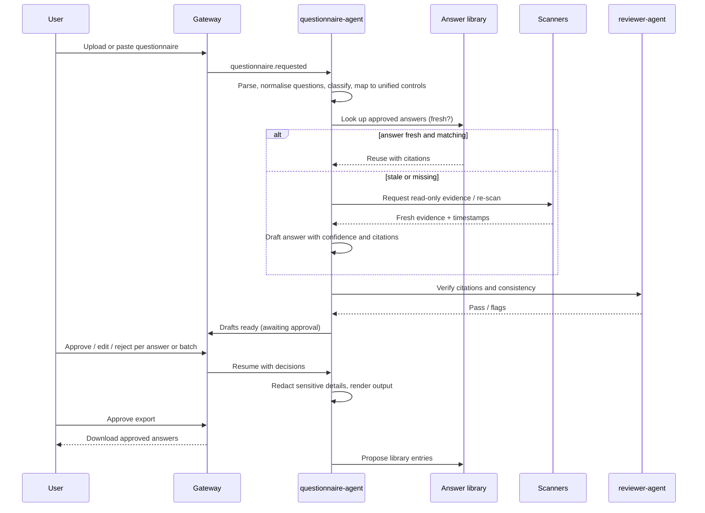

# AUCoFF Agent Spec

| Field | Value |
|-------|-------|
| Status | Draft |
| Version | 0.2.0 |
| Owner | Praveen Darshanam |
| Last updated | 2026-10-18 |

> Purpose: defines the agentic AI layer: roles, orchestration, models, tools, knowledge, guardrails, human approvals and evaluation. All agents obey constitution section 7 (AI-1 to AI-16).

Related: [constitution.md](constitution.md) · [spec.md](spec.md) · [backend-spec.md](backend-spec.md) · [database-spec.md](database-spec.md) · [api-contract.md](api-contract.md) · [design.md](design.md)

## 1. Overview and Principles
- AUCoFF runs 13 agents as Python microservices fed by RabbitMQ and orchestrated with LangGraph (ADR-3, ADR-4).
- **Deterministic first:** scanners run policy-as-code checks that produce facts (pass/fail with raw evidence). LLMs interpret, map, explain, summarise documents and draft text. LLMs never decide whether a configuration value is compliant when a deterministic rule exists.
- **Read-only:** no agent changes customer systems (spec.md 5.5, AI-1, AI-6).
- **Advisory with approval:** consequential outputs need human approval (AI-2). Outputs leaving the tenant need approval and redaction (AI-16).
- **Grounded:** every claim cites evidence or source text (AI-3); no evidence means `unknown`, not a guess (AI-4).
- **Tenant-isolated:** retrieval and tools are always tenant-scoped (DB-3, DB-6).

## 2. Agent Roster
Autonomy levels: **A0** deterministic, no LLM; **A1** LLM drafts, human decides; **A2** LLM acts inside bounded, reversible, internal steps (no external effects).

| ID | Agent (service) | Responsibility | Trigger / queue | Model tier | Autonomy | Approval gate | Refs |
|----|-----------------|----------------|-----------------|-----------|----------|---------------|------|
| AG-1 | `assessment-orchestrator` | Plans assessment graph, fans out scans, aggregates control results, requests review | `assessment.requested` | Strong (planning only) | A2 | Result finalisation | FR-3, FR-7 |
| AG-2 | `mapping-agent` | Proposes requirement-to-unified-control mappings with rationale | `mapping.requested` | Strong | A1 | Mapping approval | FR-2 |
| AG-3 | `cloud-scanner` | AWS/GCP/Azure read-only checks and evidence | `scan.cloud` | None for checks; small for summarising | A0/A2 | - | FR-6 |
| AG-4 | `k8s-scanner` | Kubernetes, Helm, RBAC, image checks | `scan.k8s` | Small | A0/A2 | - | FR-6 |
| AG-5 | `repo-scanner` | GitHub/Bitbucket and CI/CD checks | `scan.repo` | Small | A0/A2 | - | FR-6 |
| AG-6 | `saas-scanner` | Entra ID and Metabase checks | `scan.saas` | Small | A0/A2 | - | FR-6 |
| AG-7 | `document-analyzer` | Parse, chunk, embed and assess uploaded documents | `analysis.document` | Small (extraction) + Strong (assessment) | A1 | Result finalisation | FR-5, FR-7 |
| AG-8 | `remediation-advisor` | Drafts findings and advisory remediation | `finding.requested` | Strong | A1 | Risk acceptance, ticket creation | FR-8, FR-9 |
| AG-9 | `report-generator` | Builds cited reports and evidence packs | `report.requested` | Strong | A1 | Report publish | FR-12 |
| AG-10 | `reviewer-agent` | Independent second pass: checks citations resolve, claims match evidence, flags contradictions and low confidence before human review | `review.requested` | Strong (different prompt; different model where possible) | A2 | - (advisory to human) | AI-3, AI-9 |
| AG-11 | `regulatory-change-agent` | Monitors allow-listed official sources, diffs new regulation/standard versions, proposes catalogue and mapping changes | scheduled; `regchange.scan` | Strong | A1 | Catalogue/mapping change approval | FR-1, FR-2 |
| AG-12 | `copilot-agent` | Answers user questions about posture, controls, findings with citations; navigates the UI; no state changes | HTTP/SSE via gateway | Strong | A1 | - (read-only) | US-8 |
| AG-13 | `questionnaire-agent` | Drafts answers to customer due-diligence questionnaires from the answer library and live evidence | `questionnaire.requested` | Strong (answers) + Small (parsing/classification) | A1 | Answer approval; export approval | US-14 to US-17, FR-16 to FR-20 |

Agents AG-10 to AG-13 are new relative to the original service list in spec.md; see [spec.md](spec.md) section 5.6.

## 3. Orchestration (LangGraph)
- One graph per workflow, run by the owning service; state persisted with the Postgres checkpointer (`app` schema, tenant-scoped).
- Graphs:
  1. **Assessment**: plan -> fan-out scan/analysis nodes -> collect evidence -> deterministic checks -> LLM interpretation -> aggregate -> reviewer-agent -> **approval interrupt** -> finalise -> findings -> snapshot.
  2. **Mapping**: select requirements -> propose mappings -> reviewer-agent -> **approval interrupt** -> persist.
  3. **Questionnaire**: see section 10.
  4. **Regulatory change**: fetch source -> detect change -> diff -> impact analysis (affected mappings/controls) -> proposal -> **approval interrupt**.
  5. **Report**: gather approved results -> compose -> citation check -> **approval interrupt** -> render.
  6. **Copilot**: retrieve (tenant-scoped) -> answer with citations -> refuse if no grounding.
- **State** (all graphs): `tenant_id`, `agent_run_id`, `idempotency_key`, `inputs_ref`, `evidence_refs[]`, `intermediate[]`, `budget{tokens,usd,steps,deadline}`, `status`, `approvals[]`.
- **Interrupts:** a run pauses at approval nodes and resumes only when `approvals` has a decision (AI-2). Approvals expire after 7 days: the item returns to the queue and the approver is notified; nothing auto-approves.
- **Retries:** queue-level retry with exponential backoff and DLQ; node-level retries bounded (default 2); failures degrade to `unknown` with reason, never silent skips.
- **Concurrency:** fan-out limited per tenant and per provider API (TODO limits).
- **Cancellation and kill switch:** per run and per tenant (AI-12).

## 4. Model Strategy
| Tier | Used for | Default (provider-agnostic; configurable) | Notes |
|------|----------|-------------------------------------------|-------|
| Strong | Assessment interpretation, mapping, remediation, report text, questionnaire answers, reviewer, copilot, regulatory analysis | Anthropic Claude (strongest available model; ID in config) | Lower temperature; structured outputs |
| Small | Extraction, classification, routing, question parsing, summarising evidence | Anthropic Claude (small/fast model; ID in config) | Cheap, high volume |
| Embeddings | Retrieval | Provider-agnostic embedding interface; model and dimension decided at build | Dimension fixed per index (database-spec §3.4) |

- All calls go through the `LLMProvider` interface (ARC-5); model IDs, versions and parameters live in configuration and are recorded per run (AI-10).
- Routing: deterministic rules by task type; escalate small -> strong when confidence below threshold or schema validation fails twice.
- Reviewer uses a different prompt and, where available, a different model from the producer to reduce correlated errors.
- Parameters: temperature <= 0.2 for assessments and answers (TODO tune); max tokens per node; prompt caching where supported.
- Fallback: secondary provider/model on outage (TODO choice), else degrade to manual workflow (AI-15).
- **Budgets:** USD 25 cap per assessment run, USD 10 per questionnaire, configurable tenant monthly cap; alert at 80%, hard stop at 100% (`budget_exceeded`) (AI-12, NFR-8). Step, time and token budgets also per run.

## 5. Tools
All tools are allow-listed per agent, tenant-scoped, rate-limited and audit-logged (AI-6).

| Tool | Description | Access | Side effects | Agents | Approval |
|------|-------------|--------|--------------|--------|----------|
| `cloud.read` | Read-only AWS/GCP/Azure config APIs | Read | None | AG-3 | No |
| `k8s.read` | Read cluster/manifest/RBAC/image data | Read | None | AG-4 | No |
| `repo.read` | GitHub/Bitbucket settings, branch protection, CI config, scan results | Read | None | AG-5 | No |
| `saas.read` | Entra ID, Metabase configuration | Read | None | AG-6 | No |
| `evidence.store` | Write evidence (hash, provenance) to object store + DB | Write (internal) | Creates evidence rows | scanners, AG-7 | No |
| `evidence.read` | Read evidence for tenant | Read | None | most | No |
| `vector.search` | Hybrid search (pgvector + full-text) with reranking, always tenant-filtered | Read | None | AG-1, 2, 7, 8, 10, 12, 13 | No |
| `catalog.read` | Frameworks, requirements, unified controls | Read | None | most | No |
| `results.propose` | Create proposed control results/findings/mappings (status `proposed`) | Write (internal) | Creates proposals | AG-1, 2, 7, 8, 11 | Finalisation needs human |
| `doc.parse` | Parse PDF/DOCX/XLSX into text/structure | Read | None | AG-7, AG-13 | No |
| `answerlib.read` / `answerlib.propose` | Read approved answers; propose new library entries | Read / internal write | Proposal only | AG-13 | Library entry approval |
| `ticket.create` | Jira/ServiceNow ticket for a finding | Write (external) | Creates ticket | AG-8 (via gateway) | Yes |
| `notify.send` | Email/Slack/Teams notification | Write (external) | Message sent | gateway | No (configured events) |
| `web.fetch` | Fetch from allow-listed official regulatory sources | Read (external) | None | AG-11 | No (allow-list only) |
| `export.render` | Produce Excel/Word/PDF output | Internal | Creates file | AG-9, AG-13 | Export approval |
No tool performs writes against customer systems.

## 6. Knowledge and Memory
| Source | Scope | Contents | Notes |
|--------|-------|----------|-------|
| Framework/regulation texts and unified controls | Shared, read-only | Requirement text or summaries, control descriptions | Subject to licensing (spec.md R-2) |
| Tenant documents | Tenant | Policies, SOPs, audit reports | Isolated embeddings (DB-6) |
| Evidence summaries and prior results | Tenant | Summaries of collected evidence, past assessments, 12-month history snapshots | For consistency and trend context |
| Remediation playbooks / best practices | Shared or tenant | Curated guidance | Versioned |
| Answer library | Tenant | Approved questionnaire answers with source questions, evidence, approval, freshness | See section 10 |

- Chunking: structure-aware (headings/clauses/tables); chunk size and overlap TODO tune; each chunk keeps source, locator and version.
- Retrieval: hybrid (vector + Postgres full-text) with reranking; top-k and score thresholds TODO; tenant filter mandatory.
- Citation format: `{source_type, source_id, locator, excerpt, version}`; citations are resolved and verified by code (section 8).
- Freshness: evidence and answers carry timestamps; staleness thresholds per evidence type (TODO defaults, proposal 30 days for configuration evidence, 12 months for policy documents).
- Memory: short-term = graph state; long-term = database (results, snapshots, answer library). No free-form agent memory outside governed tables.
- Answer library lifecycle: `draft -> approved -> stale -> retired`; stale when underlying evidence changed or age threshold passed; retired entries not used for new answers.

## 7. Prompts
- Stored in `backend/services/<agent>/prompts/` as versioned templates; semantic version per prompt; every run records `prompt_version` (AI-10).
- Structure: system role and rules; task; schema for output; retrieved sources inside clearly delimited data blocks marked untrusted (AI-7).
- Changes go through PR with evaluation results (AI-11); no prompts edited in production.
- No secrets or PII in prompts beyond what redaction permits (AI-8).

## 8. Guardrails
| Layer | Control |
|-------|---------|
| Input | Validate sizes/types; strip hidden text/markup; detect prompt-injection patterns; treat all documents, evidence and questionnaire content as data, never instructions (AI-7) |
| Redaction | PII and secrets detected and replaced with tokens before any LLM call; reversible mapping kept server-side; redaction recall gate >= 99% |
| Tool use | Allow-list per agent; schema-validated arguments; tenant ID injected by runtime, never from model output; no tool calls that originate solely from document content without validation |
| Output | Pydantic schemas; retry/repair within limits then escalate (AI-5) |
| Citations | Citation validator: every claim must reference an existing evidence/source ID in the tenant scope, and excerpt must match source; uncited or unresolved claims are dropped or marked `unverified` (AI-3, AI-4) |
| Confidence | Model-reported plus rule-based signals (evidence freshness, coverage, reviewer disagreement); below threshold -> human queue (AI-9) |
| Disallowed | Legal conclusions or certifications, changing customer systems, exporting data outside the tenant without approval, answering from another tenant's data |
| Rate/budget | Per run and per tenant budgets, rate limits, loop detection (AI-12) |
| Egress | LLM calls only to approved providers and regions (SEC-14) |

## 9. Human-in-the-Loop Matrix
| Action | Trigger | Approver role | Timeout / default |
|--------|---------|---------------|-------------------|
| Finalise control result | Assessment graph reaches review | compliance_officer, ciso | 7 days, then back to queue + reminder; never auto-approved |
| Approve requirement-to-control mapping | Mapping or regulatory-change proposal | compliance_officer, ciso | Same |
| Accept risk on a finding | User request | ciso | Same |
| Create external ticket | User action on finding | compliance_officer, engineer | Same |
| Publish / download final report | Report graph | compliance_officer, ciso | Same |
| Approve questionnaire answer (per answer or batch) | Draft ready | compliance_officer, ciso | Same |
| Approve questionnaire export | After all selected answers approved | compliance_officer, ciso | Same |
| Apply regulatory catalogue change | Regulatory-change proposal | compliance_officer, ciso | Same |
| Add/replace answer-library entry | Approved answer | compliance_officer | Same |
Approvals record approver, time, decision and comment in `approvals` and the audit log (SEC-9).

## 10. Questionnaire Agent (AG-13) Workflow
Supports: uploaded Excel/Word/PDF questionnaires; standard templates (SIG, CAIQ, HECVAT, VSA); link/portal questionnaires (answers drafted for manual entry; **no auto-submission**); reuse of approved prior answers.

Rules:
- Answer order of preference: approved fresh library answer; fresh scan evidence; stale evidence triggers a read-only re-scan; if still insufficient the answer is `needs input` (never invented).
- Each answer shows: text, confidence, citations (evidence IDs and timestamps), source (library vs live), reviewer-agent flags, redaction summary.
- **Redaction by default:** account IDs, resource IDs, IP addresses, internal hostnames, employee names/emails, secrets. Tenant-configurable "shareable detail level" (minimal, standard, detailed); reviewer can override per answer with a reason.
- Only approved answers are exported; each export is audit-logged (who, what, when, format, recipient label).
- Answers copied into the library only after approval; library entries link to evidence and expire on staleness.
- Questionnaire documents are untrusted input (AI-7); the same guardrails apply.
- Data model (see [database-spec.md](database-spec.md)): `questionnaires`, `questionnaire_questions`, `questionnaire_answers`, `answer_library`.

## 11. Evaluation
| Area | Dataset | Metric | Initial gate |
|------|---------|--------|--------------|
| Control results | Golden evidence + expected results per framework | Agreement with reviewer judgement | >= 90% |
| Citations | All outputs | Citation correctness (citation resolves and supports claim) | >= 98% |
| Hallucination | Adversarial and sparse-evidence cases | Hallucinated/unsupported claims | <= 1% |
| Redaction | Seeded PII/secret corpus | Redaction recall | >= 99% |
| Mapping | Expert-labelled mappings | Precision/recall (TODO targets) | TODO |
| Questionnaire | Past answered questionnaires | Answer accuracy vs approved answers; reuse correctness; needs-input recall | TODO targets |
| Reviewer override | Production | Human override rate (monitor, no gate) | Track |
| Security | Prompt-injection and exfiltration suite | Attack success rate | 0 critical |
- Gates run in CI on prompt, model or agent-code changes; failures block merge (AI-11, QA-6).
- LLM calls in CI are recorded/replayed or mocked for determinism (QA-8); periodic live evaluation on schedule.
- Human feedback (approvals, edits, rejects) feeds new golden cases after review.
- Thresholds are initial and tunable by owner; changes recorded in this document.

## 12. Audit Logging and Traceability
Each run writes `agent_runs` and `agent_steps` ([database-spec.md](database-spec.md)): agent, model and version, prompt version, redacted inputs, retrieved source IDs, tool calls and results, outputs, tokens, cost, timings, approvals. Security-relevant events (approvals, exports, budget stops, guardrail blocks) also go to the immutable `audit_log` (AI-10, SEC-9). Retention per database-spec section 9.

## 13. Failure Handling and Degradation
| Failure | Behaviour |
|---------|-----------|
| LLM timeout/outage | Retry with backoff, fallback model if configured, else mark steps `failed`, keep deterministic results, notify; manual workflow remains (AI-15) |
| Invalid structured output | Repair retry (<= 2), escalate model tier, then human queue |
| Scanner/API failure or missing permission | Result `unknown` with reason; never treated as pass |
| Budget exceeded | Stop run (`budget_exceeded`), keep partial results, alert |
| Guardrail violation | Block output, log, flag for review |
| Poison message | DLQ + alert |
| Kill switch | Admin can stop a run or disable an agent per tenant |

## 14. Agent Threat Model
| Threat | Mitigation |
|--------|-----------|
| Prompt injection via documents, evidence or questionnaires | Data/instruction separation, input sanitising, no tool calls driven by content without validation, injection test suite |
| Data exfiltration through answers or exports | Redaction by default, approval before export, export audit, tenant-configurable detail level |
| Cross-tenant leakage via retrieval | Mandatory tenant filter + RLS, tenant tests (DB-6), per-tenant caches only |
| Over-privileged tools or credentials | Read-only scoped credentials, per-agent allow-lists, secret references only |
| Hallucinated compliance claims | Citation validator, reviewer-agent, confidence routing, evaluation gate |
| Cost abuse / runaway loops | Budgets, step limits, rate limits, kill switch |
| Poisoned answer library | Only approved entries, staleness, provenance links, retire workflow |
| Malicious regulatory source content | Allow-list of official sources, diffs reviewed by humans, no auto-apply |
| Model/provider data retention | Approved providers only, data class rules, region pinning (SEC-14) |

## 15. Open Questions
- [ ] Final model IDs per tier and fallback provider.
- [ ] Embedding model and dimension; reranker choice.
- [ ] Staleness thresholds per evidence type.
- [ ] Targets for mapping and questionnaire evaluation metrics.
- [ ] Allow-listed regulatory sources per jurisdiction.
- [ ] Questionnaire template licensing/format details (SIG, CAIQ, HECVAT, VSA).
- [ ] Concurrency limits per tenant and provider.
- [ ] Redaction tooling (library vs model-based) and entity list.
