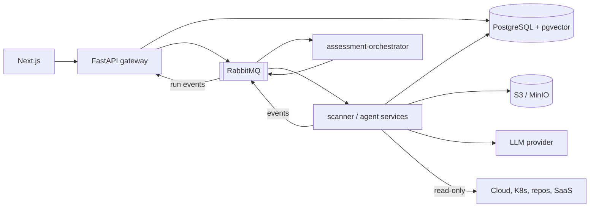

# AUCoFF Backend Spec (FastAPI + Agent Services)

| Field | Value |
|-------|-------|
| Status | Draft |
| Version | 0.2.0 |
| Owner | Praveen Darshanam |
| Last updated | 2026-10-18 |

> Purpose: services, domain logic, agent microservices and persistence behind the API defined in [api-contract.md](api-contract.md).

Related: [spec.md](spec.md) · [design.md](design.md) · [agent.md](agent.md) · [infrastructure-spec.md](infrastructure-spec.md) · [database-spec.md](database-spec.md) · [constitution.md](constitution.md)

## 1. Tech Choices
| Area | Choice | Notes |
|------|--------|-------|
| Language | Python 3.13 (pinned); FastAPI latest stable, exact version pinned at scaffold (T-002) | COD-1 |
| API | FastAPI + Pydantic v2 | OpenAPI 3.1 generated and committed |
| ORM / migrations | SQLAlchemy 2.x (async) + Alembic | [database-spec.md](database-spec.md) |
| Database | PostgreSQL 18.6 + pgvector | RLS; `SET LOCAL app.tenant_id` per transaction |
| Queue | RabbitMQ via `aio-pika` | Jobs from API to agent services |
| Agent orchestration | LangGraph | Checkpoints in PostgreSQL; interrupt nodes for human approval |
| LLM access | Provider-agnostic interface; Claude default | ARC-5, AI-8, AI-12 |
| Object store | S3 API (MinIO locally, S3 on AWS) via `boto3` | Presigned URLs |
| Cloud/SaaS SDKs | boto3, Google, Azure, GitHub/Bitbucket, Microsoft Graph, Metabase API | Read-only scopes only |
| Logging / tracing | structlog (JSON), OpenTelemetry | COD-8 |
| Tooling | Ruff, mypy, pytest, httpx, testcontainers | COD-1, QA |

## 2. Architecture
FastAPI is the single gateway for the frontend (ARC-1). Long-running work is published to RabbitMQ and executed by Python agent services; results go to PostgreSQL and progress events to the API for SSE.


## 3. Project Layout
```
backend/
  app/                    # gateway
    api/                  # routers, dependencies, schemas
    core/                 # config, security, tenancy, errors
    domain/               # entities and business rules (no I/O imports)
    db/                   # models, repositories, migrations
    messaging/            # publishers, message schemas
    integrations/         # Jira, ServiceNow, Slack, Teams, email
    llm/                  # provider interface and adapters, redaction
  services/               # one package per agent microservice
    common/               # shared worker base, queue, LLM, tracing
    mapping_agent/
    cloud_scanner/
    k8s_scanner/
    repo_scanner/
    saas_scanner/
    document_analyzer/
    assessment_orchestrator/
    remediation_advisor/
    report_generator/
  tests/
```
Rules: `api -> domain -> db/messaging/llm` only (ARC-3); services reuse `domain` and `db` packages, not `api`.

## 4. Services
| Service | Responsibility | Consumes | Produces | Spec refs |
|---------|----------------|----------|----------|-----------|
| gateway (`app`) | REST API, auth, RBAC, SSE, presigned URLs | HTTP, run events | jobs | FR-1..15 |
| `assessment-orchestrator` | Builds the LangGraph plan per assessment, fans out scanner jobs, aggregates control results | `assessment.requested` | `scan.*`, `analysis.*`, `assessment.completed` | FR-3, FR-7 |
| `mapping-agent` | Proposes requirement-to-control mappings | `mapping.requested` | mapping proposals (pending approval) | FR-2 |
| `cloud-scanner` | AWS/GCP/Azure read-only configuration collection and checks | `scan.cloud` | evidence + checks | FR-6 |
| `k8s-scanner` | Cluster/Helm/RBAC/image configuration checks | `scan.k8s` | evidence + checks | FR-6 |
| `repo-scanner` | GitHub/Bitbucket and CI/CD settings | `scan.repo` | evidence + checks | FR-6 |
| `saas-scanner` | Entra ID, Metabase | `scan.saas` | evidence + checks | FR-6 |
| `document-analyzer` | Parse, chunk, embed, RAG-assess documents | `analysis.document` | evidence + candidate results | FR-5, FR-7 |
| `remediation-advisor` | Findings and advisory remediation | `finding.requested` | findings | FR-8 |
| `report-generator` | Cited reports and evidence packs | `report.requested` | report objects | FR-12 |
| `reviewer-agent` | Independent verification of citations/conclusions | `review.requested` | review flags | AI-3 |
| `regulatory-change-agent` | Monitor allow-listed sources; propose catalogue changes | `regchange.scan` (scheduled) | change proposals | FR-20 |
| `copilot-agent` | Read-only cited Q&A | HTTP/SSE via gateway | answers | FR-21 |
| `questionnaire-agent` | Due-diligence questionnaire drafting | `questionnaire.requested` | drafted answers, exports | FR-16..19 |
Agent details, tools and guardrails: [agent.md](agent.md).
All scanners are read-only (spec.md 5.5, AI-1, AI-6).

### 4a. Scanner Adapters and Check Engine
Decision (owner): **wrap proven open-source scanners behind our own scanner interface** instead of writing all rules from scratch.
- **Adapter interface:** `collect(scope, credentials_ref) -> RawFindings`, `normalise(raw) -> CheckResult[]`, `describe() -> {tool, version, required_permissions, licence}`. One adapter per tool; adapters run inside the scanner service container or as sandboxed jobs.
- **Candidate tools (to be confirmed per source; licence and maintenance reviewed before adoption):**
  | Source | Candidates |
  |--------|-----------|
  | AWS / GCP / Azure | Prowler, Steampipe (with compliance mods), ScoutSuite |
  | Kubernetes / containers | kubescape, kube-bench, Trivy |
  | Repos / CI-CD / IaC | Checkov, Semgrep, GitHub/Bitbucket APIs (custom adapter) |
  | Entra ID, Metabase | Custom adapters (Microsoft Graph, Metabase API) |
- **Normalised result schema:** `check_id`, `tool`, `tool_version`, `rule_pack_version`, `resource_ref`, `status` (pass/fail/error/not_applicable), `severity`, `evidence_ref`, `raw_ref`, `observed_at`.
- **Rule metadata:** AUCoFF maintains `check_definitions` (tool check ID -> unified control(s), severity override, rationale, applicability) so scan results roll up into control results ([database-spec.md](database-spec.md) §3.7). Mappings are versioned and reviewed like control mappings.
- **Rule packs:** pinned tool versions + rule sets per release (`rule_pack_version`); upgrades go through the evaluation suite; results always record tool and rule versions for reproducibility.
- **Gaps:** controls with no automated check are assessed from documents/evidence uploads or marked `unknown`; custom checks (OPA/Rego or Python) may be added behind the same interface when OSS coverage is missing.
- **Supply chain:** tools pinned by digest, scanned, SBOM'd; licence compatibility reviewed (some tools have non-OSS or commercial-use restrictions) - constitution SEC-17.
- **Least privilege:** each connector documents the exact read-only permissions it needs (appendix, filled per connector); `validate()` rejects broader grants where detectable.

## 5. Messaging
- Broker: RabbitMQ; durable topic exchange `aucoff.jobs`, per-service queues, dead-letter exchange `aucoff.dlx` with per-queue DLQs.
- Message envelope (JSON): `message_id`, `idempotency_key`, `tenant_id`, `assessment_id`, `agent_run_id`, `type`, `schema_version`, `payload`, `trace_context`, `created_at`.
- Delivery: at-least-once; consumers MUST be idempotent (DES-4); manual acks after commit; retries with exponential backoff, max attempts then DLQ and alert.
- Outbox: the API writes the job row and an outbox record in one transaction; a relay publishes to RabbitMQ (avoids lost messages).
- Tenant context travels in the envelope; consumers set `app.tenant_id` before any DB access.
- Run events (`run.step`, `run.status`, `run.cost`) published to `aucoff.events` and relayed by the gateway as SSE.

## 6. Job and Run Lifecycle
`queued -> running -> awaiting_approval -> completed` with `failed`, `cancelled`, `budget_exceeded` terminals. Transitions are validated in `domain`, persisted in `agent_runs`, and audit-logged. Cancellation propagates through the queue. Time, step and cost budgets enforced per run (AI-12).

## 7. Connectors
- A connector per source type with a common interface: `validate()`, `collect(scope)`, `describe_permissions()`.
- Credentials: per-tenant secret references (`integrations.config_ref`); secrets retrieved at run time from the secret store, held in memory only, never logged or sent to LLMs (SEC-3).
- Required permissions are read-only and documented per connector; `validate()` fails if broader permissions are detected (warning to admin).
- Rate limiting and backoff per provider API; partial failure recorded as `unknown` results, not silently skipped.
- Evidence stored in the object store with SHA-256 and provenance (source, time, collector version).

## 8. Auth, RBAC and Tenancy
- JWTs from the external OIDC provider are validated (signature via JWKS, issuer, audience, expiry); tenant and roles mapped from claims.
- Roles: compliance_officer, auditor, engineer, executive, ciso, admin (database-spec `roles`). Permission matrix (TODO to finalise):

| Capability | compliance_officer | auditor | engineer | executive | ciso | admin |
|------------|:--:|:--:|:--:|:--:|:--:|:--:|
| View catalogues | x | x | x | x | x | x |
| Approve mappings | x | | | | x | |
| Manage scopes / run assessments | x | | | | x | |
| Manage connectors | | | x | | | x |
| Review / approve results | x | | | | x | |
| View evidence | x | x | x | | x | |
| Manage findings | x | | x | | x | |
| Generate / download reports | x | x | | x | x | |
| View audit log | | x | | | x | x |
| Manage users / SSO / integrations | | | | | | x |

- Every request opens a transaction with `SET LOCAL app.tenant_id`; missing tenant fails closed (DB-3).
- Authorisation checks in `domain`/dependencies, never only in routers (SEC-1).

Additional roles and permissions (decisions 2026-10-19):
| Capability | platform_admin (operator) | external_auditor (scoped, time-boxed) | notes |
|-----------|:--:|:--:|-------|
| Provision/suspend tenants, offboarding workflows | x | | Operator-provisioned, invite-based tenants in v1 |
| Access tenant data | break-glass only | scoped read-only | See below |
| View assigned assessments, evidence, results, reports, audit log slice | | x | Limited to invited assessments/frameworks until expiry |
| Questionnaires: view/create/draft | | | compliance_officer, ciso (approve/export), engineer (read) |
| Questionnaire approve / export | | | compliance_officer, ciso |
| Answer library manage | | | compliance_officer |
| Regulatory-change approve | | | compliance_officer, ciso |
| Copilot | | x (scoped data only) | All authenticated users, within their data access |
| History / compare / export | | x (scoped) | report:read scopes |
- **Break-glass:** operator access to tenant data requires a time-limited grant (reason, approver, expiry, tenant notified), is read-only by default, and is fully audit-logged (SEC-15).
- **External auditors:** invited by a tenant admin or compliance officer with scope (assessments/frameworks) and expiry; no access outside scope; every view audit-logged (SEC-16).

## 9. LLM and Agent Integration
- `llm` package defines `LLMProvider` (chat, tool use, embeddings) with adapters (Claude default); model, version and parameters from configuration.
- Redaction pipeline (PII/secrets) runs before every outbound call (AI-8); redaction rules versioned and tested.
- Prompts live in versioned files; every run records `prompt_version`, model, token usage and cost (AI-10).
- LangGraph graphs: state persisted via the Postgres checkpointer; approval steps use interrupts so a run resumes only after an `approvals` decision (AI-2). Details in [agent.md](agent.md).
- Structured outputs validated by Pydantic; invalid output retried within limits then escalated (AI-5).
- Retrieval: tenant-filtered pgvector queries only (DB-6).

## 10. Integrations
| System | Direction | Notes |
|--------|-----------|-------|
| Jira, ServiceNow | Create/update tickets for findings; sync status | Webhook or polling (TODO) |
| Slack, Microsoft Teams, email | Notifications for findings and approvals | Per-event preferences |
| Identity provider | OIDC login, SAML via IdP | Admin configured |
Credentials via secret references; outbound calls have timeouts, retries and circuit breakers.

## 11. Configuration and Secrets
Per-tenant connector credentials live in a dedicated secret store addressed by `config_ref` (HashiCorp Vault-style or AWS Secrets Manager on AWS; Kubernetes Secrets are acceptable only for local development and do not scale to many tenants). Tenant secrets are encrypted with per-tenant keys where the store supports it.
12-factor environment config (ARC-8) validated by Pydantic Settings at start-up; values from Helm values/ConfigMaps; secrets from Kubernetes Secrets (Secrets Manager on AWS); no defaults for secrets; config documented in [infrastructure-spec.md](infrastructure-spec.md).

## 12. Observability
Structured JSON logs with `request_id`, `tenant_id`, `agent_run_id` (no PII or secrets); OpenTelemetry traces across API, queue and services; Prometheus metrics (request latency, queue depth, run durations, LLM tokens/cost, scanner errors); health endpoints (`/health/live`, `/health/ready`).

## 13. Error Handling
Domain exceptions map to the problem-detail format in [api-contract.md](api-contract.md); unexpected errors return a generic message with a request ID and are logged with stack traces; no internals leaked (COD-6).

## 14. OWASP API Security Top 10 Mapping (NFR-1)
| Risk | Control |
|------|---------|
| API1 Broken object level authorisation | Tenant RLS + per-object ownership checks; UUIDs |
| API2 Broken authentication | OIDC JWT validation, short-lived tokens |
| API3 Broken object property level authorisation | Explicit response schemas; no mass assignment |
| API4 Unrestricted resource consumption | Rate limits, pagination caps, upload limits, LLM budgets |
| API5 Broken function level authorisation | RBAC matrix enforced in domain |
| API6 Unrestricted access to sensitive business flows | Approval gates, idempotency keys, quotas |
| API7 Server-side request forgery | Allow-listed connector endpoints, no user-supplied URLs fetched blindly |
| API8 Security misconfiguration | Hardened images, secure defaults, config validation, security headers |
| API9 Improper inventory management | OpenAPI as the only source of routes; deprecation policy |
| API10 Unsafe consumption of APIs | Validate third-party and LLM responses; timeouts |

## 15. Testing Plan
- Unit: `domain` at >= 90% coverage (QA-3).
- Integration: PostgreSQL 18.6 + RabbitMQ via testcontainers; migrations, RLS and privilege tests ([database-spec.md](database-spec.md) section 10).
- Contract: generated OpenAPI equals committed `openapi.yaml`; schemathesis-style fuzz against it.
- Messaging: idempotency, retry, DLQ behaviour.
- Agents: evaluation suites with golden datasets; LLM calls mocked or replayed in CI (QA-6, QA-8).
- Security: SAST, dependency audit, DAST/API scan against kind deployment.

## 16. Open Questions
- [x] Python 3.13 + latest stable FastAPI (pin exact FastAPI version at scaffold).
- [ ] Final permission matrix and custom roles.
- [ ] Ticket sync: webhook vs polling.
- [ ] Per-scanner concurrency and rate limits.
- [x] Embeddings: hosted embedding API via the provider interface, 1024 dimensions (placeholder; re-embed via migration if the model changes).
- [ ] Checkpointer retention policy for LangGraph state.
