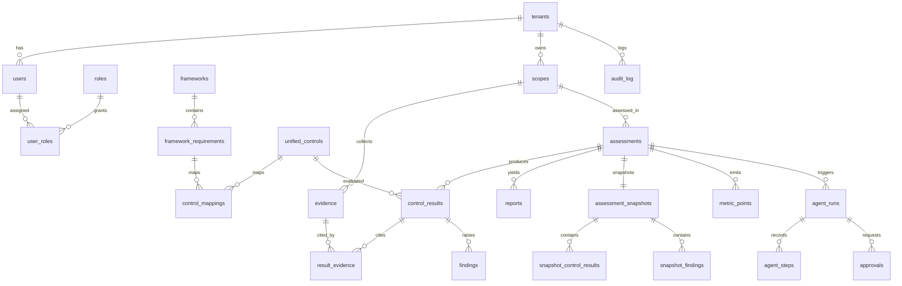

# AUCoFF Database Spec

| Field | Value |
|-------|-------|
| Status | Approved (v1 baseline, owner sign-off 2026-10-19) |
| Version | 0.8.0 |
| Owner | Praveen Darshanam |
| Last updated | 2026-10-19 |

> Purpose: the database engine, schema, migrations and secure configuration for AUCoFF. Implements constitution rules ARC-6, DES-1, COD-9, SEC-2 to SEC-5, SEC-9 to SEC-11 and DB-1 to DB-8.

Related: [constitution.md](constitution.md) · [design.md](design.md) · [backend-spec.md](backend-spec.md) · [agent.md](agent.md) · [infrastructure-spec.md](infrastructure-spec.md) · [api-contract.md](api-contract.md)

## 1. Engine, Name and Versions
| Item | Value | Notes |
|------|-------|-------|
| Engine | PostgreSQL 18.6 | Confirmed by owner |
| Database name | `aucoff` | One database; tenant isolation by `tenant_id` + RLS |
| Vector extension | `pgvector` 0.8.6 | Owner-confirmed compatible with PostgreSQL 18.6; confirm a CloudNativePG-compatible image exists (T-004) |
| Other extensions | `pgcrypto`, `pg_audit` (TODO confirm availability in the local image), `pg_stat_statements` | |
| ORM | SQLAlchemy 2.x (async) | See [backend-spec.md](backend-spec.md) |
| Migrations | Alembic | Versioned, forward-only in prod (COD-9) |
| Driver | `asyncpg` (TODO confirm) | |
| Pooling | PgBouncer (local sidecar/chart in v1; hosted option post-v1) | |

### Environments
| Env | Deployment | Notes |
|-----|-----------|-------|
| local | PostgreSQL 18.6 + pgvector 0.8.6 via the CloudNativePG operator (`deploy/postgres/`; minimal PostgreSQL image + pgvector image volume, both digest-pinned; the standard image is NOT used because it bundles its own newer pgvector), PVC storage | Synthetic data only (ENV-2) |
| aws (post-v1, out of scope) | RDS or Aurora PostgreSQL | Confirm 18.x and `pgvector` support if/when a hosted environment is built; see section 12 |

## 2. Conventions
- Names: `snake_case`; tables plural; one schema `app` for domain tables, `audit` for the audit log, `ref` for reference data (frameworks, controls).
- Primary keys: UUID v7 (time-ordered), column `id`. (PostgreSQL 18 provides `uuidv7()` natively - verify.)
- Every tenant-owned table has `tenant_id uuid NOT NULL` (ARC-6).
- Timestamps: `timestamptz` in UTC; `created_at`, `updated_at` on mutable tables.
- Append-only tables (DES-1): no `updated_at`; changes are new rows.
- Deletion: soft delete (`deleted_at`) for user-facing entities; hard delete only via the retention job (section 9).
- Enums: PostgreSQL `CHECK` constraints on text columns or lookup tables (avoid native enum types so migrations stay simple).
- JSON: `jsonb` only for flexible payloads (evidence metadata, agent step I/O); core fields are columns.
- Money/scores: `numeric`, never float, where precision matters.

## 3. Tables

### 3.1 Tenancy and identity (`app`)
| Table | Purpose | Key columns |
|-------|---------|-------------|
| `tenants` | Customer organisation | `id`, `name`, `slug` (unique), `region` (data residency), `status`, `created_at` |
| `users` | People | `id`, `tenant_id`, `email` (unique per tenant), `display_name`, `idp_subject`, `status`, `last_login_at` |
| `roles` | Role definitions | `id`, `name` (compliance_officer, auditor, engineer, executive, ciso, admin), `permissions jsonb` |
| `user_roles` | Role assignment | `tenant_id`, `user_id`, `role_id` (PK on the three) |
| `integrations` | Ticketing (Jira, ServiceNow), notification (Slack, Teams, email) and SSO configuration | `id`, `tenant_id`, `type`, `config_ref` (secret reference, never the secret), `status` |
| `connectors` | Evidence source connectors (cloud, Kubernetes, repos, Entra ID, Metabase); maps to API `/connectors` | `id`, `tenant_id`, `type`, `name`, `config_ref` (secret reference), `permissions_checked_at`, `status` |
| `tenant_settings` | Per-tenant configuration | `tenant_id`, `region`, `history_retention_months` (>= 13), `evidence_retention_days`, `llm_monthly_budget_usd`, `questionnaire_detail_level`, `settings jsonb` |

### 3.2 Reference and unified controls (`ref`, shared across tenants, read-only to the app role)
| Table | Purpose | Key columns |
|-------|---------|-------------|
| `frameworks` | Regulation/standard | `id`, `code` (e.g. `pci_dss_4_0_1`), `name`, `version`, `jurisdiction`, `type` (framework, regulation, messaging-standard) |
| `framework_requirements` | Clause-level requirement | `id`, `framework_id`, `ref` (clause number), `title`, `text`, unique(`framework_id`, `ref`) |
| `unified_controls` | Normalised AUCoFF control | `id`, `code`, `title`, `description`, `domain` |
| `control_mappings` | Requirement to unified control | `requirement_id`, `unified_control_id`, `strength`, `rationale`, `source` (human/agent), `approved_by`, `approved_at` |

### 3.3 Assessments (`app`)
| Table | Purpose | Key columns |
|-------|---------|-------------|
| `scopes` | What is assessed (systems, frameworks) | `id`, `tenant_id`, `name`, `framework_ids uuid[]`, `target_refs jsonb` |
| `evidence` | Collected artefact metadata | `id`, `tenant_id`, `scope_id`, `source_type` (cloud, k8s, repo, document, saas), `source_ref`, `object_key` (object store), `sha256`, `collected_at`, `classification` |
| `assessments` | One assessment run set | `id`, `tenant_id`, `scope_id`, `status`, `started_at`, `completed_at`, `created_by` |
| `control_results` | Result per unified control | `id`, `tenant_id`, `assessment_id`, `unified_control_id`, `status` (pass, fail, partial, not_applicable, unknown), `confidence`, `summary`, `agent_run_id`, `reviewed_by`, `reviewed_at` |
| `result_evidence` | Links results to evidence with citations | `control_result_id`, `evidence_id`, `citation` |
| `findings` | Gaps | `id`, `tenant_id`, `control_result_id`, `severity`, `title`, `description`, `recommendation`, `status`, `ticket_ref`, `opened_at`, `closed_at` |
| `reports` | Generated audit reports | `id`, `tenant_id`, `assessment_id`, `format`, `object_key`, `sha256`, `generated_by`, `generated_at` |

### 3.4 Agents and approvals (`app`)
| Table | Purpose | Key columns |
|-------|---------|-------------|
| `agent_runs` | One agent execution | `id`, `tenant_id`, `agent_id`, `assessment_id`, `model`, `model_version`, `prompt_version`, `status`, `input_tokens`, `output_tokens`, `cost_usd numeric`, `started_at`, `finished_at` |
| `agent_steps` | Tool calls and outputs (append-only) | `id`, `tenant_id`, `agent_run_id`, `seq`, `kind`, `input_redacted jsonb`, `output jsonb`, `created_at` |
| `approvals` | Human decisions on agent actions | `id`, `tenant_id`, `agent_run_id`, `action`, `requested_at`, `decided_by`, `decision`, `decided_at`, `comment` |
| `embeddings` | RAG vectors | `id`, `tenant_id` (NULL for shared reference text), `source_type`, `source_id`, `chunk_index`, `content`, `embedding vector(1024)` (hosted embedding model via the provider interface; re-embed by migration if the model changes), `model`. Shared reference chunks (`tenant_id` NULL) are readable by all tenants and writable only by the migrator/catalogue loader: RLS uses separate policies (`SELECT` allows `tenant_id = current tenant OR tenant_id IS NULL`; `INSERT/UPDATE/DELETE` require `tenant_id = current tenant`) |

### 3.4b Questionnaires (`app`) - see [agent.md](agent.md) section 10
| Table | Purpose | Key columns |
|-------|---------|-------------|
| `questionnaires` | Uploaded/created due-diligence questionnaire | `id`, `tenant_id`, `name`, `template` (sig, caiq, hecvat, vsa, custom), `source_type` (file, link), `object_key`, `requester_label`, `status`, `detail_level`, `created_by`, `created_at` |
| `questionnaire_questions` | Normalised questions | `id`, `tenant_id`, `questionnaire_id`, `position`, `text`, `category`, `unified_control_ids uuid[]` |
| `questionnaire_answers` | Drafted/approved answers (append-only versions) | `id`, `tenant_id`, `question_id`, `version`, `text`, `source` (library, live, manual), `confidence`, `citations jsonb`, `evidence_ts timestamptz`, `redaction_summary jsonb`, `status` (draft, approved, rejected, needs_input), `decided_by`, `decided_at` |
| `answer_library` | Approved reusable answers | `id`, `tenant_id`, `question_text`, `answer_text`, `unified_control_ids uuid[]`, `evidence_ids uuid[]`, `status` (approved, stale, retired), `approved_by`, `approved_at`, `fresh_until`, embedding via `embeddings` |
| `questionnaire_exports` | Export audit | `id`, `tenant_id`, `questionnaire_id`, `format`, `object_key`, `answer_ids uuid[]`, `exported_by`, `exported_at`, `recipient_label` |
All tables have RLS (DB-3); exports also write to `audit.audit_log`.

### 3.4a Orchestration support (`app`)
| Table | Purpose |
|-------|---------|
| `outbox` | Transactional outbox for RabbitMQ publishing ([backend-spec.md](backend-spec.md) section 5): `id`, `tenant_id`, `type`, `payload jsonb`, `created_at`, `published_at` |
| `idempotency_keys` | API idempotency records: `tenant_id`, `key`, `request_hash`, `response jsonb`, `expires_at` |
| LangGraph checkpoint tables | Created by the LangGraph Postgres checkpointer in schema `app`; MUST carry `tenant_id` (or be keyed by run ID joined to `agent_runs`) and be covered by RLS - design TODO |

### 3.5 Audit (`audit`)
Implementation note (migration 0001): chain order uses a per-tenant `chain_pos` assigned inside the per-tenant advisory lock, not the global `seq`, because `seq` is assigned before the trigger runs and concurrent writers could otherwise interleave (a race found and fixed by the concurrency test on 2026-10-19). `audit.verify_chain` also detects deleted rows (gaps in `chain_pos`).
| Table | Purpose | Key columns |
|-------|---------|-------------|
| `audit_log` | Immutable security/compliance events (SEC-9) | `id`, `tenant_id`, `occurred_at`, `actor_type`, `actor_id`, `action`, `target_type`, `target_id`, `outcome`, `request_id`, `details jsonb`, `prev_hash`, `row_hash` |

`row_hash = sha256(prev_hash || canonical row)` per tenant, giving tamper evidence (SEC-10).

### 3.6 History and metrics (`app`) - 12-month comparison
| Table | Purpose | Key columns |
|-------|---------|-------------|
| `assessment_snapshots` | Immutable summary of each completed assessment | `id`, `tenant_id`, `assessment_id`, `scope_id`, `captured_at`, `formula_version`, `posture_score numeric`, `coverage_pct numeric`, `status_counts jsonb`, `severity_counts jsonb`, `framework_coverage jsonb`, `jurisdiction_coverage jsonb` |
| `snapshot_control_results` | Per-control result as of the snapshot (append-only copy) | `snapshot_id`, `tenant_id`, `unified_control_id`, `status`, `severity`, `confidence`, `evidence_ids uuid[]`, `evidence_hashes text[]`, `approved_by`, `approved_at` |
| `snapshot_findings` | Findings as of the snapshot | `snapshot_id`, `tenant_id`, `finding_id`, `severity`, `status`, `opened_at` |
| `metric_points` | Time series of catalogue metrics | `id`, `tenant_id`, `metric_id` (M-01..M-20), `scope_id`, `framework_id` (nullable), `jurisdiction` (nullable), `dimension jsonb`, `value numeric`, `captured_at`, `assessment_id`, `formula_version` |
| `metric_rollups` | Daily/weekly/monthly aggregates (materialised views or tables) | `tenant_id`, `metric_id`, `granularity`, `period_start`, `value`, `min`, `max`, `count` |
- Snapshots and metric points are written once, in the same transaction as assessment finalisation, and are **immutable** (no UPDATE/DELETE for `aucoff_app`; DB-9).
- Snapshot rows store evidence IDs and SHA-256 hashes so history stays comparable after evidence files are deleted under retention.
- Partition `snapshot_control_results`, `snapshot_findings` and `metric_points` by month on `captured_at`.
- Indexes: (`tenant_id`, `scope_id`, `captured_at DESC`) on `assessment_snapshots`; (`tenant_id`, `metric_id`, `captured_at`) on `metric_points`; (`tenant_id`, `unified_control_id`, `snapshot_id`) on `snapshot_control_results`.
- Queries: "latest scan vs previous two" uses the three newest snapshots for a scope; any-to-any comparison joins two snapshots on `unified_control_id`; per-control history reads `snapshot_control_results` over the last 12 months.
- Changing a metric formula increments `formula_version`; old points keep their version (displayed with a marker); recompute jobs write new versions rather than editing.

### 3.7 Check engine, scheduling, notifications, copilot, access control (`app`)
| Table | Purpose | Key columns |
|-------|---------|-------------|
| `rule_packs` | Versioned scanner tool + rule-set bundles | `id`, `tool`, `tool_version`, `rule_pack_version`, `licence`, `released_at`, `status` |
| `check_definitions` | Tool check -> unified control mapping (shared reference, `ref` schema) | `id`, `rule_pack_id`, `tool_check_id`, `unified_control_ids uuid[]`, `severity_override`, `applicability jsonb`, `rationale`, `approved_by`, `approved_at` |
| `check_results` | Normalised scanner output per resource | `id`, `tenant_id`, `assessment_id`, `check_definition_id`, `resource_ref`, `status`, `severity`, `evidence_id`, `observed_at`, `rule_pack_version` |
| `scope_schedules` | Scan schedules (US-24) | `id`, `tenant_id`, `scope_id`, `cron`, `timezone`, `enabled`, `last_run_at`, `next_run_at` |
| `notification_preferences` | Per-user event/channel settings | `tenant_id`, `user_id`, `event_type`, `channel`, `enabled` |
| `notifications` | Delivered/in-app notifications | `id`, `tenant_id`, `user_id`, `event_type`, `payload jsonb`, `created_at`, `read_at` |
| `copilot_conversations`, `copilot_messages` | Copilot history (retention configurable) | `id`, `tenant_id`, `user_id`, `created_at`; messages: `conversation_id`, `role`, `content_redacted`, `citations jsonb`, `agent_run_id` |
| `regulatory_changes` | Proposed catalogue/mapping changes from the regulatory-change agent | `id`, `framework_id`, `source_url`, `detected_at`, `diff jsonb`, `impact jsonb`, `status`, `decided_by`, `decided_at` (shared reference; who approves - operator or tenant - is TODO) |
| `evidence_uploads` | Presigned upload sessions and scan status | `id`, `tenant_id`, `scope_id`, `object_key`, `declared_type`, `size`, `sha256`, `malware_scan_status`, `status`, `expires_at` |
| `auditor_invitations` | Time-boxed external auditor access | `id`, `tenant_id`, `email`, `scope jsonb` (assessment/framework IDs), `invited_by`, `expires_at`, `accepted_at`, `revoked_at` |
| `operator_access_grants` | Break-glass access for platform operators | `id`, `tenant_id`, `operator_id`, `reason`, `approved_by`, `starts_at`, `expires_at`, `revoked_at`, `read_only` |
All tenant tables have RLS (DB-3). Break-glass sessions set the tenant context only while a valid grant exists; grants and every access are mirrored to `audit.audit_log`. Retention for new tables follows section 9 (check results with assessment evidence; copilot messages configurable, default TODO; invitations and grants kept with audit retention).

## 4. Relationships (ER overview)

## 5. Indexes and Constraints
- B-tree on (`tenant_id`, `id`) for every tenant table; foreign keys always include `tenant_id` where the parent is tenant-owned (composite FK) so cross-tenant links are impossible.
- `control_results`: unique (`assessment_id`, `unified_control_id`); index on (`tenant_id`, `status`).
- `findings`: index on (`tenant_id`, `status`, `severity`).
- `embeddings`: HNSW index on `embedding` (cosine), plus (`tenant_id`, `source_type`, `source_id`). Tenant filter MUST be applied in every similarity query.
- `audit_log`: index on (`tenant_id`, `occurred_at`) and (`tenant_id`, `target_type`, `target_id`); partition by month on `occurred_at`.
- `agent_runs` / `agent_steps`: partition by month once volume warrants (threshold TODO).
- CHECK constraints for status/severity vocabularies; NOT NULL by default.

## 6. Secure Configuration

### 6.1 Roles and privileges (SEC-2)
| DB role | Used by | Privileges |
|---------|---------|------------|
| `aucoff_migrator` | Alembic migration Job only | **Owns the database and all objects** (the earlier separate `aucoff_owner` was dropped: CloudNativePG's bootstrap owner must be a login role); DDL on `app`, `ref`, `audit`; its credential is used only by the migration Job |
| `aucoff_app` | **NOLOGIN group role** holding the runtime privileges: DML on `app`; `SELECT` on `ref`; `INSERT`-only on `audit.audit_log`; no DDL; subject to RLS | (never logs in) |
| `aucoff_gateway`, `aucoff_svc_<service>` | One **login role per service** (gateway and each agent service), each a member of `aucoff_app` and granted only the extra privileges that service needs | Own credential per service (ZT-6) |
| `aucoff_readonly` | Reporting/support | `SELECT` on `app` (subject to RLS); no PII columns where avoidable |
| `aucoff_audit_reader` | Auditor export | `SELECT` on `audit.audit_log` |

No role is superuser; `aucoff_app` and every per-service role have `NOBYPASSRLS`. Services never share a login role, and none uses the migrator or owner role.

### 6.2 Row-Level Security (SEC-11, ARC-6)
- RLS enabled and FORCED on every tenant table.
- Policy: `tenant_id = current_setting('app.tenant_id')::uuid`; the API sets `SET LOCAL app.tenant_id` per transaction from the authenticated token. Missing setting = no rows (fail closed, DES-3).
- Shared reference tables carry no tenant data and are read-only.
- RLS tests are mandatory (section 10).

### 6.3 Authentication and transport
- `scram-sha-256` password auth only (or TLS client certificates); no `trust`, `md5`, `password`, or network `peer`/`ident`. CloudNativePG always appends a final `host all all all scram-sha-256` rule that cannot be replaced, so TLS is enforced by a preceding `hostnossl all all all reject` rule (verified 2026-10-19: a non-TLS connection is rejected with "pg_hba.conf rejects connection ... no encryption"). Network superuser logins fail (`enableSuperuserAccess: false`).
- Every connection is authenticated with the calling service's **own** credential (ZT-6); credentials are unique per service and environment, come from the secret store, and are rotated. The application never connects as a superuser.
- TLS required (`hostssl` only), TLS 1.2+ ; certificates managed by the platform (cert-manager locally in v1; ACM/RDS CA post-v1).
- Credentials come from Kubernetes Secrets locally in v1 (a managed secret store is post-v1); never in images, values files in git, logs or prompts (SEC-3). Rotation procedure TODO.

### 6.4 Encryption
- At rest: encrypted volumes locally where available; KMS-encrypted storage is a post-v1 hosted option.
- Column-level: sensitive fields (e.g. integration tokens if stored, evidence classified restricted) encrypted with an application-managed key (`pgcrypto` or app-side envelope encryption, TODO decide). Prefer storing only secret references (`config_ref`).
- Backups encrypted.

### 6.5 Network and hardening
- Database reachable only from backend/worker pods (Kubernetes NetworkPolicy); not exposed via Ingress or NodePort.
- Run as non-root; read-only root filesystem where supported; resource limits set.
- `log_connections`, `log_disconnections`, `log_statement = ddl`; `pg_audit` for role/DDL events (TODO); logs exclude bind values to avoid leaking PII.
- `statement_timeout`, `idle_in_transaction_session_timeout` and `lock_timeout` set for `aucoff_app`.
- Public schema privileges revoked; `search_path` fixed per role.
- Cardholder data (PAN, CVV) MUST NOT be stored (SEC-6); an automated check scans schema and sampled data for PAN patterns.

## 7. Migrations (COD-9)
- Alembic revisions in `backend/app/db/migrations/`; one logical change per revision; names `YYYYMMDD_HHMM_short_description`.
- Never edit a merged revision; fix forward.
- Destructive changes use expand/contract in separate releases.
- Migrations run as `aucoff_migrator` in a Helm pre-upgrade hook Job locally (v1); a CI/CD job in a hosted environment is post-v1.
- Every migration is tested on an empty DB and on the previous release's schema in CI.
- Row-Level Security, grants and extensions are managed in migrations, not by hand.

## 8. Data Classification
| Class | Examples | Handling |
|-------|----------|----------|
| Restricted | Evidence content, credentials references, audit details | Encrypted, access logged, tenant-scoped, minimal retention |
| Confidential | User identity, findings, reports | Encrypted, RBAC |
| Internal | Agent runs metadata, costs | RBAC |
| Public/reference | Own summaries and clause references of frameworks (no verbatim copyrighted text unless licensed, LIC-6), unified controls | Read-only |

## 9. Retention, Deletion and Residency (SEC-5, SEC-10, SEC-14)
| Data | Retention | Deletion |
|------|-----------|----------|
| Audit log | TODO (proposal: 7 years) | Never edited; partitions dropped only after retention |
| Evidence and reports | TODO per tenant policy | Object + metadata deletion job, logged |
| Agent steps | TODO (proposal: 13 months) | Partition drop |
| Assessment snapshots, snapshot results/findings, metric points | At least 13 months (12 months visible); tenant-extendable, never below 12 months; rollups kept longer (TODO) | Partition drop after retention; exempt from evidence deletion; never edited |
| User data | Account life + TODO | Erasure on request (GDPR/DPDP) with audit-log pseudonymisation |
- Each tenant has a `region`; tenant data MUST reside only in that region's database/storage (deployment-per-region model TODO in [design.md](design.md)).

## 10. Testing
- Migration tests: up from empty, up from previous version, downgrade where supported.
- RLS tests: for every tenant table, a session with tenant A cannot read or write tenant B and sees nothing when `app.tenant_id` is unset.
- Privilege tests: `aucoff_app` cannot `UPDATE`/`DELETE` `audit_log`, cannot DDL.
- Audit hash chain verification test.
- Embedding queries always include tenant filter (test with two tenants).
- Seed data: synthetic only (ENV-2).

## 11. Backup, Restore and DR
- Local: scheduled `pg_dump`/volume snapshot for developer convenience (TODO).
- Post-v1 (AWS): automated backups plus PITR; RPO/RTO targets TODO (proposal: RPO 15 min, RTO 4 h).
- Restore drills documented and rehearsed per phase.

## 12. Post-v1: AWS Migration Notes (informational, not built in v1)
| Local | AWS | Notes |
|-------|-----|-------|
| In-cluster PostgreSQL 18.6 + pgvector 0.8.6 | RDS/Aurora PostgreSQL | Confirm 18.x availability and the supported `pgvector`/`pg_audit` versions per engine version |
| PgBouncer | RDS Proxy or PgBouncer | TODO |
| K8s Secret credentials | Secrets Manager with rotation | IAM auth optional |
| cert-manager TLS | RDS CA bundle | |
| PVC storage | gp3/io2 with KMS | |

## 13. Open Questions
- [x] Embedding dimension 1024 (placeholder). [x] pgvector 0.8.6 with PostgreSQL 18.6 (owner-confirmed). [ ] Image source compatible with CloudNativePG still to verify (T-004).
- [x] Local deployment: CloudNativePG operator with a pgvector-enabled image.
- [ ] Column-level encryption approach and key management.
- [ ] Retention periods and RPO/RTO targets.
- [ ] Tenant region model: one database per region vs per tenant.
- [ ] Licensing for storing framework text (PCI DSS, ISO standards are copyrighted).

## Implementation note: check definitions and results (2026-10-20)

Until the tables in section 3.7 exist, `check_definitions` and `rule_packs` live as reviewed files in `data/checks/` (the rule pack carries tool, tool version, rule pack version and licence; each definition maps a tool check to unified control IDs with a severity and rationale) and are validated against `data/controls` in tests. Scanner output (`check_results`, `evidence`) is currently written as `report.json` plus content-addressed files by the scanner run; the migration that moves all of it into PostgreSQL with row-level security and `tenant_id` is still to do (T-102, T-103).
