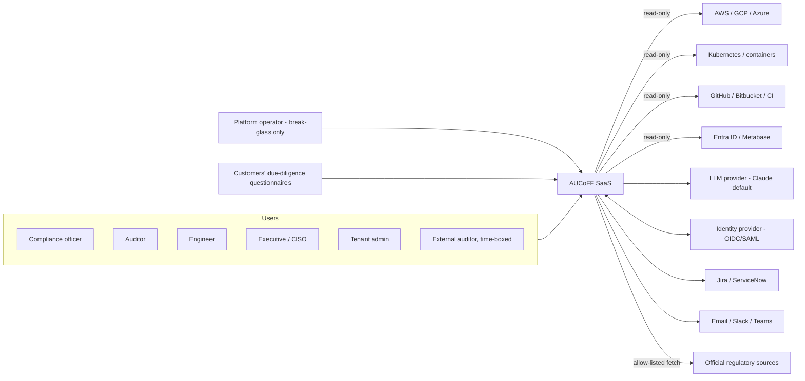
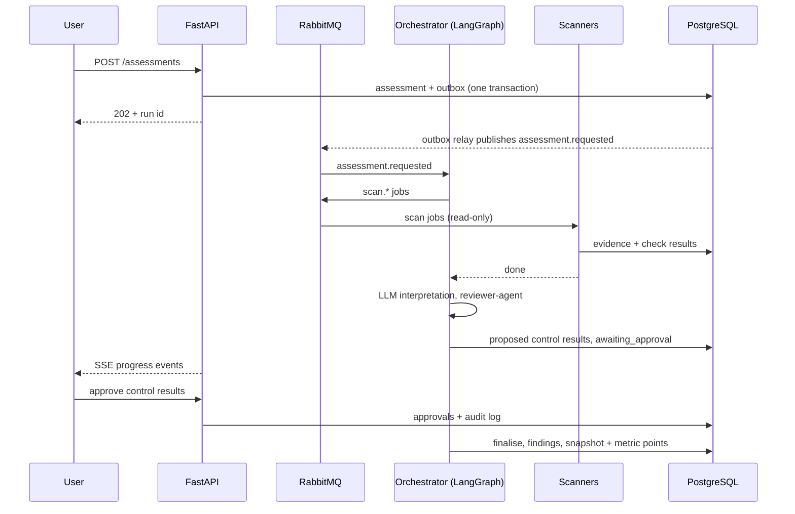

# AUCoFF Design

| Field | Value |
|-------|-------|
| Status | Draft |
| Version | 0.6.1 |
| Owner | Praveen Darshanam |
| Last updated | 2026-10-19 |

> Purpose: system architecture, key technical decisions, and the UX and visual design (colour, layout, information and metrics) that satisfy [spec.md](spec.md) within [constitution.md](constitution.md).

Related: [frontend-spec.md](frontend-spec.md) · [backend-spec.md](backend-spec.md) · [agent.md](agent.md) · [api-contract.md](api-contract.md) · [infrastructure-spec.md](infrastructure-spec.md) · [database-spec.md](database-spec.md)

## 1. System Context

Trust boundaries: (1) browser/user, (2) AUCoFF platform, (3) customer environments (read-only), (4) LLM provider (redacted data only), (5) external recipients of exports (approved, redacted data only).

## 2. Architecture Overview
Next.js frontend (BFF session) -> FastAPI gateway -> PostgreSQL (+ pgvector) and RabbitMQ -> Python agent microservices (LangGraph) -> read-only external sources, object store and LLM provider. Diagram in [backend-spec.md](backend-spec.md) section 2; deployment topology in [infrastructure-spec.md](infrastructure-spec.md).

## 3. Components
| Component | Responsibility | Tech | Spec |
|-----------|----------------|------|------|
| Web UI | Dashboards, review and approval workflows | Next.js | [frontend-spec.md](frontend-spec.md) |
| API | REST gateway, auth, RBAC, SSE | FastAPI | [backend-spec.md](backend-spec.md) |
| Agent runtime | 13 agents / microservices, LangGraph graphs | Python, LangGraph | [agent.md](agent.md) |
| Relational DB + vector store | System of record, RLS tenancy, embeddings, history snapshots | PostgreSQL 18.6 + pgvector | [database-spec.md](database-spec.md) |
| Queue | Job and event transport | RabbitMQ (post-v1 hosted option: Amazon MQ) | [backend-spec.md](backend-spec.md) §5 |
| Object store | Evidence files, reports, exports | S3-compatible store locally (MinIO is AGPL-3.0, not approved; candidate SeaweedFS to be confirmed under T-009), S3 on AWS | [infrastructure-spec.md](infrastructure-spec.md) |
| Identity provider | OIDC login, SAML brokering | Keycloak locally; Entra ID/Cognito later | [frontend-spec.md](frontend-spec.md) §5 |
| Observability | Logs, metrics, traces | OpenTelemetry, Prometheus + permissively licensed dashboards/logs/traces (Grafana/Loki/Tempo are AGPLv3, not approved; Perses and VictoriaLogs are candidates, T-009) | [infrastructure-spec.md](infrastructure-spec.md) §8 |

## 4. Data Model
Defined in [database-spec.md](database-spec.md) sections 3 to 5 (tables, ER diagram, indexes). Design-level decisions:
- Single database; tenant isolation by `tenant_id` + Row-Level Security.
- Append-only audit and agent-step tables with hash-chained audit rows.
- Embeddings stored in PostgreSQL via `pgvector`.
- **History:** each completed assessment writes an immutable snapshot and metric points; at least 12 months (stored 13) of history are queryable for any-to-any scan comparison (section 12; [database-spec.md](database-spec.md) section 3.6).

## 5. Key Data Flows
### 5.1 Assessment run

### 5.2 Evidence to report
Evidence collected/uploaded -> hashed and stored -> checks/analysis -> proposed results with citations -> reviewer-agent -> human approval -> findings and remediation advice -> snapshot (history) -> report generation -> approval -> download.
### 5.3 Questionnaire
Detailed in [agent.md](agent.md) section 10.
### 5.4 Progress streaming
Services publish run events to RabbitMQ; the gateway relays them to the browser via SSE ([api-contract.md](api-contract.md) section 6).

## 6. Security Architecture
- **AuthN/AuthZ:** external OIDC IdP; JWT validated by the API on **every** request; BFF session cookie for the browser; RBAC enforced in domain code (SEC-1). **No anonymous endpoint exists anywhere**, including health, docs and metrics (ZT-1).
- **Service-to-service and data-plane authentication:** per-service identities (OAuth2 client credentials, short-lived audience-scoped tokens), per-service RabbitMQ users, per-service PostgreSQL and object-store credentials, all over TLS (ZT-4 to ZT-6). NetworkPolicies are defence in depth, not the control. Kubernetes probes use `exec`, not HTTP (ZT-7).
- **Tenancy:** `tenant_id` + forced RLS; tenant context set per transaction; tenant-filtered vector queries (SEC-11, DB-3, DB-6).
- **Data protection:** TLS everywhere; encryption at rest; column-level encryption for restricted fields; classification and retention in [database-spec.md](database-spec.md) (SEC-4, SEC-5).
- **Secrets:** Kubernetes Secrets on the local cluster in v1 (managed secret store post-v1); connector credentials only by reference (SEC-3).
- **LLM data boundary:** only redacted data to approved providers/regions (AI-8, SEC-14).
- **Outputs leaving the tenant:** approved, redacted, audit-logged (AI-16).
- **Network:** default-deny NetworkPolicies; DB reachable only from backend/agents ([infrastructure-spec.md](infrastructure-spec.md) §4).
- **Supply chain:** pinned dependencies, SBOM, image scanning, secret scanning (COD-7, SEC-8).

### Threat model summary (STRIDE)
| Threat | Example | Mitigation |
|--------|---------|-----------|
| Spoofing | Forged token, stolen session | OIDC validation, short-lived tokens, httpOnly cookies, MFA at IdP |
| Tampering | Edit audit trail or evidence | Append-only audit with hash chain, evidence SHA-256, immutable snapshots |
| Repudiation | Denied approval | Approvals with actor/time in audit log |
| Information disclosure | Cross-tenant read, prompt/export leak | RLS, tenant-filtered retrieval, redaction, export approval |
| Denial of service | Runaway scans/LLM spend | Rate limits, budgets, kill switch, queue backpressure |
| Elevation of privilege | Over-broad connector or role | Read-only scoped credentials, RBAC matrix, least privilege roles |
| Prompt injection | Malicious document content | Data/instruction separation, validation, injection tests ([agent.md](agent.md) §8, §14) |

## 7. Observability
Logs, metrics, traces via OpenTelemetry into Prometheus and permissively licensed log/trace/dashboard backends chosen under T-009; SLOs from NFR-3/NFR-4 with burn-rate alerts ([infrastructure-spec.md](infrastructure-spec.md) §8). Product-level metrics shown to users are defined in section 11 and are separate from operational telemetry.

## 8. Decision Log (ADRs)
| ID | Decision | Alternatives | Rationale | Status |
|----|----------|--------------|-----------|--------|
| ADR-1 | PostgreSQL 18.6 with pgvector as the single data store (relational + vectors) | Separate vector DB (e.g. Qdrant), MySQL | One engine to secure and operate; RLS for multi-tenancy; maps to RDS/Aurora | Accepted (owner) |
| ADR-2 | Multi-tenant SaaS with RLS isolation | Single-tenant per deployment | Required by [spec.md](spec.md) section 5.4 | Accepted (owner) |
| ADR-3 | LangGraph for agent orchestration with Postgres checkpoints | Claude Agent SDK/plain loops, Temporal | Graph state, interrupts for human approval | Accepted (owner) |
| ADR-4 | FastAPI gateway + Python agent services over RabbitMQ | Sync gRPC/HTTP, modular monolith | Decouples long-running scans; retries and DLQs | Accepted (owner) |
| ADR-5 | External OIDC IdP (Keycloak locally) with BFF session in Next.js | Built-in auth, SaaS auth | Enterprise SSO/SAML, no tokens in browser storage | Accepted (owner) |
| ADR-6 | OpenAPI 3.1 as source of truth; generated TS client; Swagger UI for all endpoints | Hand-written clients | Prevents contract drift | Accepted (owner) |
| ADR-7 | kind + umbrella Helm chart; Terraform + EKS only post-v1 | minikube, per-service charts | Same chart across environments; kind is lighter and matches CI | Accepted (owner) |
| ADR-13 | **v1 (MVP) is local-only on kind: no AWS or other cloud hosting; everything tested on a laptop** | Early AWS deployment | Faster feedback, no cloud cost or compliance surface in MVP; images and chart stay portable | Accepted (owner) |
| ADR-14 | **Zero-trust authentication: every API, internal or external, and every service-to-service, service-to-database and service-to-broker call is authenticated; no anonymous health/docs/metrics endpoints; token-based service identity over TLS (no mTLS in v1)** | Network-position trust, anonymous probes, mesh mTLS | Owner requirement; removes the largest class of internal-network attack paths; keeps v1 simple on kind | Accepted (owner) |
| ADR-15 | Traefik (not ingress-nginx) as the local ingress controller; dashboard and API disabled | ingress-nginx (retired after March 2026), Envoy Gateway | Maintained, MIT-licensed, supports Ingress resources; avoids an unmaintained internet-facing component | Accepted |
| ADR-8 | Immutable per-assessment snapshots + metric points for 12-month history, rollups for trends | Recompute from live data | Reproducible comparisons independent of later data changes | Proposed |
| ADR-9 | Light-default theme with dark mode, token-based design system (shadcn/ui + Tailwind) | Single theme, other UI kits | Owner choice; accessibility and consistency | Accepted (owner) |
| ADR-10 | Wrap vetted open-source scanners behind our adapter interface; map checks to unified controls | Write all rules in OPA/Rego | Broad coverage quickly; keep our control logic and versioning | Accepted (owner) |
| ADR-11 | Operator-provisioned, invite-based tenants; audited break-glass operator access; time-boxed external auditor access | Self-service signup, standing operator access | Controlled onboarding and least privilege in v1 | Accepted (owner) |
| ADR-12 | Permissive-licence-only policy (constitution LIC-1 to LIC-8): replace any FOSS-licence or provenance issue with an alternative | Allow copyleft tools as separate services | Avoid licence and plagiarism risk for a commercial SaaS | Accepted (owner) |

## 9. Trade-offs and Risks
- Single PostgreSQL for relational, vector and history data simplifies operations but concentrates load; mitigate with partitioning, read replicas and PgBouncer when needed.
- Doing all frameworks in v1 is a scope risk (spec.md R-1); internal milestones in [tasks.md](tasks.md).
- LLM-dependent features (interpretation, questionnaires) add cost and variability; mitigated by deterministic-first checks, budgets and evaluation gates.
- Storing snapshots for 13 months increases storage; mitigated by compact metric points and partition dropping.
- Hybrid RAG quality depends on embedding choice, deferred to build.

## 10. UX and Visual Design

### 10.1 Principles
1. **Number-first:** every screen leads with quantified, comparable data; narrative comes second.
2. **Evidence-first:** any claim is one click from its source and timestamp.
3. **Trust through transparency:** AI output is labelled, cited, and shows confidence and approval state.
4. **Calm by default:** quiet neutral canvas; colour is reserved for meaning (status, severity, action).
5. **Accessible and inclusive:** WCAG 2.2 AA; colour is never the only signal.
6. **Professional with personality:** modern, friendly (Gen-Z) touches that never reduce clarity.

### 10.2 Colour system
Implemented as CSS variables (Tailwind theme tokens); light is the default and dark mode follows `prefers-color-scheme` with a user override. Contrast ratios below were computed against the stated backgrounds (WCAG 2.2: text >= 4.5:1, UI components >= 3:1).

**Surfaces and text**
| Token | Light | Dark |
|-------|-------|------|
| `bg` | `#FFFFFF` | `#0B1220` |
| `surface` (cards) | `#F8FAFC` | `#111A2E` |
| `border-subtle` (decorative) | `#E2E8F0` | `#1E293B` |
| `border-control` (inputs, focusable UI) | `#64748B` (4.76:1 on `bg`) | `#64748B` (3.93:1 on `bg`) |
| `text` | `#0F172A` (17.85:1) | `#E5E7EB` (15.12:1) |
| `text-muted` | `#475569` (7.58:1) | `#9CA3AF` (7.37:1) |

**Brand and accent**
| Token | Light | Dark | Use |
|-------|-------|------|-----|
| `brand-deep` | `#0B2A6F` (13.33:1; white text on it 13.33:1) | `#93C5FD` | Sidebar, headings accents, hero KPI backgrounds |
| `brand` (blue) | `#1D4ED8` (6.70:1; white text on it 6.70:1) | `#60A5FA` (7.36:1) | Primary buttons, links, focus ring |
| `accent-teal` | `#0F766E` (5.47:1; white text 5.47:1) | `#2DD4BF` (10.06:1) | Secondary actions, highlights, positive-neutral accents |
| `highlight-yellow` | `#FACC15` (fill only; use `#854D0E` text on it, 6.85:1 on white) | `#FACC15` | Callouts, "new" badges |

Brand scale for hover/pressed/tint states: deep blue 900 `#0B2A6F`, 700 `#123C99`, 600 `#1D4ED8`, 100 `#DBEAFE`, 50 `#EFF6FF` (tints are fills only).

**Compliance status (always icon + label + colour)**
| Status | Icon | Light text/icon | Dark text/icon | Tint fill (light / dark) |
|--------|------|-----------------|----------------|--------------------------|
| Pass | check-circle | `#15803D` (5.02:1) | `#4ADE80` (10.74:1) | `#DCFCE7` / `#052E16` |
| Partial | alert-triangle | `#B45309` (5.02:1) | `#FBBF24` (11.22:1) | `#FEF3C7` / `#422006` |
| Fail | x-circle | `#B91C1C` (6.47:1) | `#F87171` (6.77:1) | `#FEE2E2` / `#450A0A` |
| Unknown | help-circle | `#4B5563` (7.56:1) | `#9CA3AF` (7.37:1) | `#F3F4F6` / `#1F2937` |
| Not applicable | minus-circle | `#475569` (7.58:1) | `#94A3B8` (7.30:1) | `#F1F5F9` / `#1E293B` |
| Awaiting approval | clock | `#1D4ED8` (6.70:1) | `#60A5FA` (7.36:1) | `#DBEAFE` / `#172554` |

**Severity (findings and failing controls)**
| Severity | Light | Dark | Icon/shape |
|----------|-------|------|------------|
| Critical | `#B91C1C` (6.47:1) | `#F87171` (6.77:1) | double-chevron up |
| High | `#C2410C` (5.18:1) | `#FB923C` (8.27:1) | chevron up |
| Medium | `#A16207` (4.92:1) | `#FACC15` (12.23:1) | dash |
| Low | `#0369A1` (5.93:1) | `#38BDF8` (8.74:1) | chevron down |
| Info | `#4B5563` (7.56:1) | `#9CA3AF` (7.37:1) | info |
Severity order is also encoded by icon shape and label, so Critical vs High is distinguishable without colour.

**Data-visualisation palette** (colour-blind-safe categorical, used for frameworks/series, max 8): `#1D4ED8` blue, `#0F766E` teal, `#B45309` amber, `#7C3AED` violet, `#BE185D` magenta, `#4B5563` grey, `#0369A1` sky, `#65A30D` lime; dark mode uses the same hues lightened (+2 steps). Sequential scale for coverage/heatmaps: blue tints `#EFF6FF` -> `#1D4ED8`; diverging for deltas: red (worse) <-> neutral <-> green (better) with arrows and +/- text. Status colours are used in charts only for status/severity data, never for arbitrary series.

**Usage rules**
- Colour never carries meaning alone: pair with icon, label or pattern (stripes for fail in print/greyscale).
- Gradients and glass/blur are allowed only on hero KPI cards (brand-deep to blue at low angle, text white >= 4.5:1).
- One primary action per view in `brand`; destructive actions in `fail` red with confirmation.
- Focus ring: 2 px `brand` with 2 px offset, visible in both themes.
- Do not use yellow for text; use `#854D0E` text on yellow fill.
- Hex values are a starting proposal and live in one tokens file; any change re-runs the contrast check.

### 10.3 Typography, shape and motion
- **Font:** Inter (UI) with system fallback; tabular numerals for all metrics and tables; large bold numerals for KPIs (32-48 px).
- **Scale (px):** 12 caption, 14 body/table, 16 default, 20 section title, 24 page title, 32-48 KPI.
- **Spacing:** 4 px base grid (4/8/12/16/24/32/48).
- **Shape and depth:** radius 8 px (controls), 12 px (cards, dialogs); soft shadows (`0 1px 2px` and `0 8px 24px` at low opacity); generous whitespace; 1 px subtle borders.
- **Icons:** Lucide, 16/20 px, stroke 1.75.
- **Motion:** 120-200 ms ease-out micro-interactions (hover lift, count-up for KPIs, progress shimmer, check-mark pop on approval); all motion disabled or reduced under `prefers-reduced-motion`.
- **Empty states:** friendly line illustrations (monochrome with a brand accent) with a clear next action.
- **Voice:** concise, plain, supportive; avoids jargon where possible.

### 10.4 Layout
App shell:
```
+------------------------------------------------------------------+
| TOP BAR: [Tenant v]  [ Search (Ctrl+K) ........ ]  [Bell] [Theme] [User v] |
+-----------+------------------------------------------------------+
| SIDEBAR   | Breadcrumbs                                          |
| (collaps- | Page title ........................ [Primary action]  |
|  ible)    | [Filters / time range / framework / jurisdiction]    |
| Dashboard | ---------------------------------------------------- |
| Assess-   |  CONTENT (cards / tables / charts)        | DRAWER   |
|  ments    |                                           | (detail, |
| Controls  |                                           |  evidence|
| Findings  |                                           |  citation)|
| Evidence  |                                           |          |
| Question- |                                           |          |
|  naires   |                                           |          |
| Reports   |                                           |          |
| Audit log |                                           |          |
| Settings  |                                           |          |
+-----------+------------------------------------------------------+
```
- **Sidebar:** deep-blue (`brand-deep`) in both themes; icon + label; collapses to icons; items filtered by role (e.g. auditors see Evidence, Reports, Audit log; admins see Settings). Copilot opens as a right-side panel from the top bar.
- **Top bar:** tenant switcher, global command/search, notifications, theme toggle, user menu, and a **global time-range and scan selector** that drives trend widgets.
- **Page header:** title, status chips, primary action, secondary actions in an overflow menu.
- **Detail drawer:** right-side, 480-640 px, for control result, finding and evidence details without losing list context.
- **Grid:** 12 columns, 24 px gutters; max content width 1440 px.
- **Breakpoints:** desktop >= 1280 (full), tablet 768-1279 (sidebar collapsed, drawer becomes overlay), mobile < 768 (dashboard, approvals and notifications only; other routes show a read-only simplified view).
- **Density:** comfortable by default (row 48 px); compact toggle (row 36 px), remembered per user.

### 10.5 Screens and information shown
**Dashboard (landing; metrics first).** Role-aware presets (section 10.7).
```
+-----------------------------------------------------------------+
| KPI strip (hero cards): Posture score | Coverage % | Open findings |
|                         Pending approvals | Evidence freshness   |
+-----------------------------------+-----------------------------+
| Coverage by framework (bars/rings)| Control status distribution |
| with delta vs previous scan       | (pass/partial/fail/unknown) |
+-----------------------------------+-----------------------------+
| Severity counts: now vs last 2    | Findings aging + MTTR       |
| scans (grouped bars, delta arrows)|                             |
+-----------------------------------+-----------------------------+
| 12-month trend (posture score,    | Jurisdiction heatmap        |
| coverage, open critical/high)     | (India / EU / US x framework)|
+-----------------------------------+-----------------------------+
| Pending approvals + agent activity| Upcoming audits / expiries  |
+-----------------------------------+-----------------------------+
| Agent quality + LLM cost vs budget (collapsible section)        |
+-----------------------------------------------------------------+
```
Every card shows: value, unit, delta vs comparison scan (arrow + number + colour), small sparkline, last updated time, and a link to drill down.

**Other screens**
| Screen | Primary content |
|--------|-----------------|
| Assessments | Table of runs (status, scope, frameworks, started, duration, coverage, cost); run detail with live timeline (SSE), per-scanner status, budget gauge |
| Assessment compare | Pick any two scans: summary deltas, lists of new / resolved / regressed / unchanged controls and findings, severity delta chart |
| Control result review | Controls table with status, confidence, severity; drawer with AI summary (AI badge), citations, evidence, history timeline, approve/reject/edit |
| Control history | Per-control timeline over the last 12 months with status changes, evidence changes, approvals |
| Findings | Table + board view; filters by severity, framework, jurisdiction, status, age; aging chart; ticket links |
| Evidence | List with source, freshness, classification; viewer with highlights; upload |
| Questionnaires | Queue; side-by-side question | draft answer | citations/evidence | status/approval; redaction preview; export approval; answer library tab |
| Reports | Generate/list/download; selected framework, period, included approvals |
| Audit log | Filterable events; integrity check button |
| Regulatory changes | Proposed diffs with impact on mappings; approve/reject |
| Copilot panel | Chat with cited answers; refusal when ungrounded |
| Admin | Users, roles, SSO, connectors, integrations, budgets, retention, detail level |

### 10.6 Interaction patterns
- Global **time range** selector: Last 2 scans (default), 30 days, 90 days, 12 months, custom; scan picker for comparisons.
- Delta display: `▲ +4.2 pts` / `▼ -3` with colour (better = green, worse = red) and text; neutral = grey.
- Drill-down: clicking any chart segment applies filters to the underlying table.
- Chart accessibility: data-table toggle for every chart; keyboard focus on points; descriptive `aria-label`s.
- AI content: `AI` badge, confidence indicator (number + bar), citation chips, approval state chip.
- States: skeleton loaders; empty states with illustration and next step; error states with request ID; partial-data banners when scanners failed.

### 10.7 Persona dashboards
| Persona | Default widgets (in order) |
|---------|---------------------------|
| Executive / risk owner | Posture score, coverage by framework, 12-month trend, severity now vs last 2 scans, jurisdiction heatmap, upcoming audits |
| CISO | Posture score, severity delta, open critical/high with aging, pending approvals, regulatory changes, agent quality, cost |
| Compliance officer | Pending approvals, coverage by framework, control status, assessments in progress, questionnaires queue, evidence freshness |
| Engineer | Open findings assigned, aging, remediation cycle time, failing controls by system, scan status |
| Auditor | Control status by framework, evidence freshness, audit-log integrity, reports, 12-month history |
| Tenant admin | Connectors health, user/role changes, budget and cost, retention settings |
| External auditor | Scoped view only: assigned assessments, results, evidence, audit-log slice, time remaining on access |
| Platform operator | Separate operator console: tenant list/health, provisioning, break-glass grants (no tenant data by default) |

## 11. Metrics Catalogue
All metrics are tenant-scoped, computed from snapshots/metric points ([database-spec.md](database-spec.md) §3.6) and exposed via the metrics endpoints ([api-contract.md](api-contract.md) §5.6). "History" = window available for comparison (all >= 12 months unless noted).

| ID | Metric | Definition / formula | Source | Visual | Roles | Colour/threshold rule |
|----|--------|----------------------|--------|--------|-------|----------------------|
| M-01 | Posture score | Weighted % of in-scope unified controls with approved `pass` (partial = 0.5; unknown = 0), weighted by control criticality; 0-100 | `control_results` snapshot | KPI + sparkline + 12-month line | All except admin | >= 85 green, 70-84 amber, < 70 red (proposal) |
| M-02 | Control coverage % | Controls with an approved result and evidence / in-scope controls | snapshot | KPI + bars per framework | All | Same as M-01 |
| M-03 | Framework coverage | M-02 per framework and jurisdiction | snapshot | Bars/rings, heatmap | All | Sequential blue; delta arrow |
| M-04 | Status distribution | Counts of pass / partial / fail / unknown / n/a / awaiting approval | snapshot | Stacked bar / donut | All | Status colours + icons |
| M-05 | Severity counts (current vs last 2 scans) | Count of open failing controls/findings by severity (critical/high/medium/low) for latest scan and two previous scans, with deltas | snapshot, `findings` | Grouped bars + delta chips | CISO, exec, compliance, engineer | Increases red, decreases green |
| M-06 | Severity trend | M-05 over 12 months by scan | metric points | Stacked area/line | CISO, exec | Severity colours |
| M-07 | Open findings aging | Open findings bucketed 0-7, 8-30, 31-90, >90 days by severity | `findings` | Stacked bars | CISO, engineer | >90 days red outline |
| M-08 | Remediation cycle time | Median (and p90) days from finding opened to resolved | `findings` | KPI + trend | CISO, engineer, exec | Lower is better |
| M-09 | Time to audit readiness | Days from scope creation to first approved report, per framework | `scopes`, `reports` | KPI + trend | Exec, CISO, compliance | Lower is better |
| M-10 | Evidence freshness | % of evidence within its freshness threshold; count of stale items | `evidence` | KPI + bar by source | Compliance, auditor, engineer | < 90% amber, < 75% red (proposal) |
| M-11 | Scan duration | Median/p95 minutes per scanner and assessment | `agent_runs` | Bar/box + trend | Engineer, admin | Over SLO amber |
| M-12 | Pending approvals | Count and oldest age by type | `approvals` | KPI + list | Compliance, CISO | > 5 days amber, > 7 days red (expiry) |
| M-13 | Agent citation correctness | % of citations verified valid by validator (and by reviewer sample) | eval/run data | KPI + trend | CISO, admin | Gate >= 98% |
| M-14 | Agent confidence | Mean confidence and % low-confidence routed to humans | `control_results` | Histogram | Compliance, CISO | Info |
| M-15 | Reviewer override rate | % of agent proposals edited/rejected by humans | `approvals` | KPI + trend | CISO, compliance | Rising rate flagged |
| M-16 | LLM tokens and cost vs budget | Tokens and USD per run, tenant per month vs cap | `agent_runs` | Gauge + trend | Admin, CISO | 80% amber, 100% red |
| M-17 | Jurisdiction coverage matrix | Coverage % by jurisdiction x framework | snapshot | Heatmap | Exec, CISO, compliance | Sequential blue |
| M-18 | Questionnaire throughput | Questionnaires received/completed, answer reuse %, median turnaround | `questionnaires`, `answer_library` | KPI + trend | Compliance, CISO | Info |
| M-19 | Scan-to-scan change | Count of new / resolved / regressed / unchanged controls between two chosen scans | snapshots | Delta table + chart | Compliance, auditor, CISO | Regressed red, resolved green |
| M-20 | Audit-log integrity | Last hash-chain verification time and result | `audit_log` | Status chip | Auditor, CISO | Failed = red alert |
Each metric stores its formula version so historical values remain interpretable if definitions change.

## 12. Historical Data and Comparison (12 months)
- Every completed assessment writes an **immutable snapshot** (control results, statuses, severities, scores, framework and jurisdiction coverage) and **metric points** for the metrics above.
- Retention: at least 13 months (12 months visible plus one month buffer); tenants may extend, never shorten below 12 months. Snapshots survive later evidence deletion (metadata and hashes retained) so comparisons stay valid.
- Comparison: any two scans can be compared (M-19); defaults are the latest vs the previous scan, and M-05 always shows the latest and the two previous scans.
- Trends: daily/weekly/monthly rollups power 30/90-day and 12-month charts.
- Export: history can be exported (CSV/JSON) for auditors.

## 13. Accessibility
WCAG 2.2 AA target: contrast verified per section 10.2; keyboard-first navigation (command palette, drawer focus trap); screen reader labels on charts with data-table alternative; reduced motion support; minimum 24 px target size; no colour-only encoding; forms with clear errors; zoom to 200% without loss.

## 14. Open Questions
- [ ] Final brand name, logo and illustration style.
- [ ] Confirm score weighting for posture score (M-01) and colour thresholds.
- [ ] Charting library (Recharts vs visx) and heatmap implementation.
- [ ] Whether to offer a high-contrast theme.
- [ ] Localisation priorities (India/EU languages).
- [ ] Print/PDF styling for reports and dashboards.
- [ ] Final snapshot retention above 13 months and storage budget.
